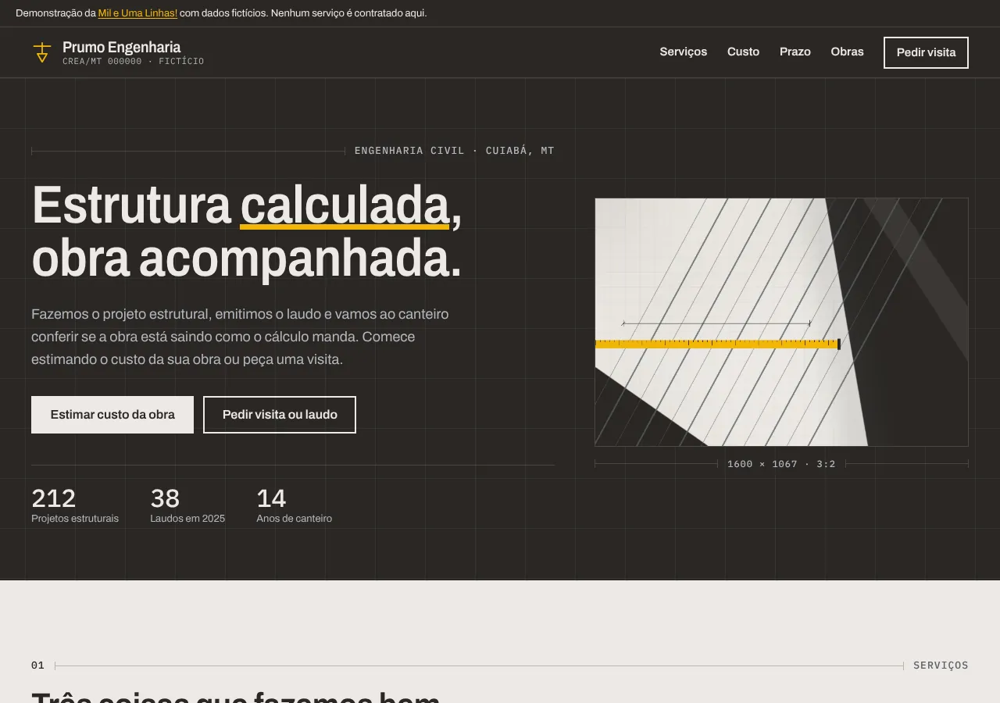
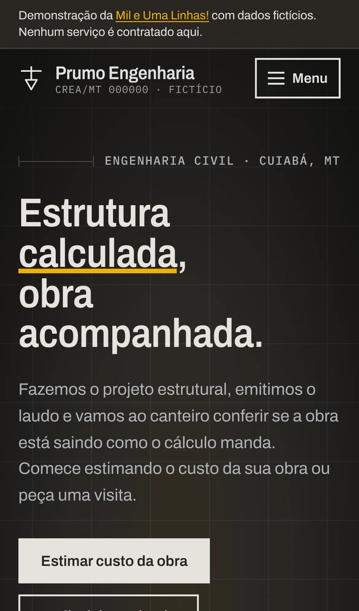
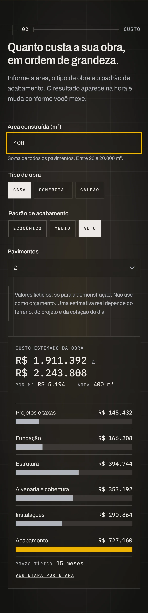
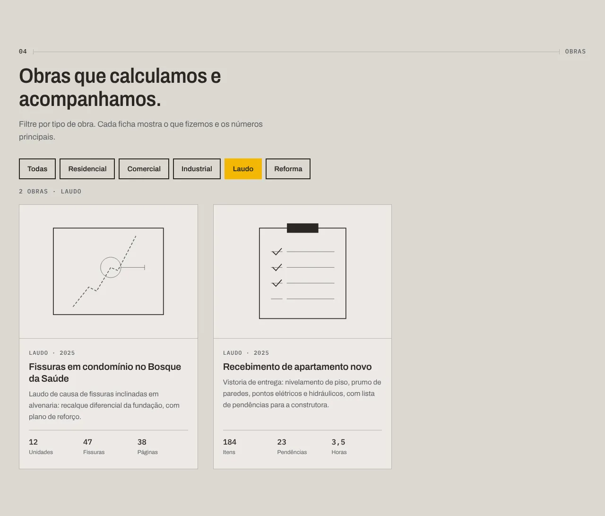
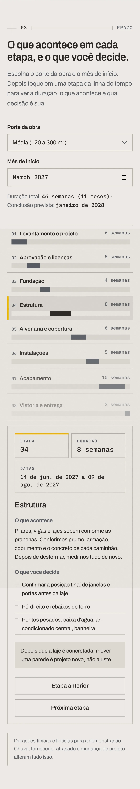
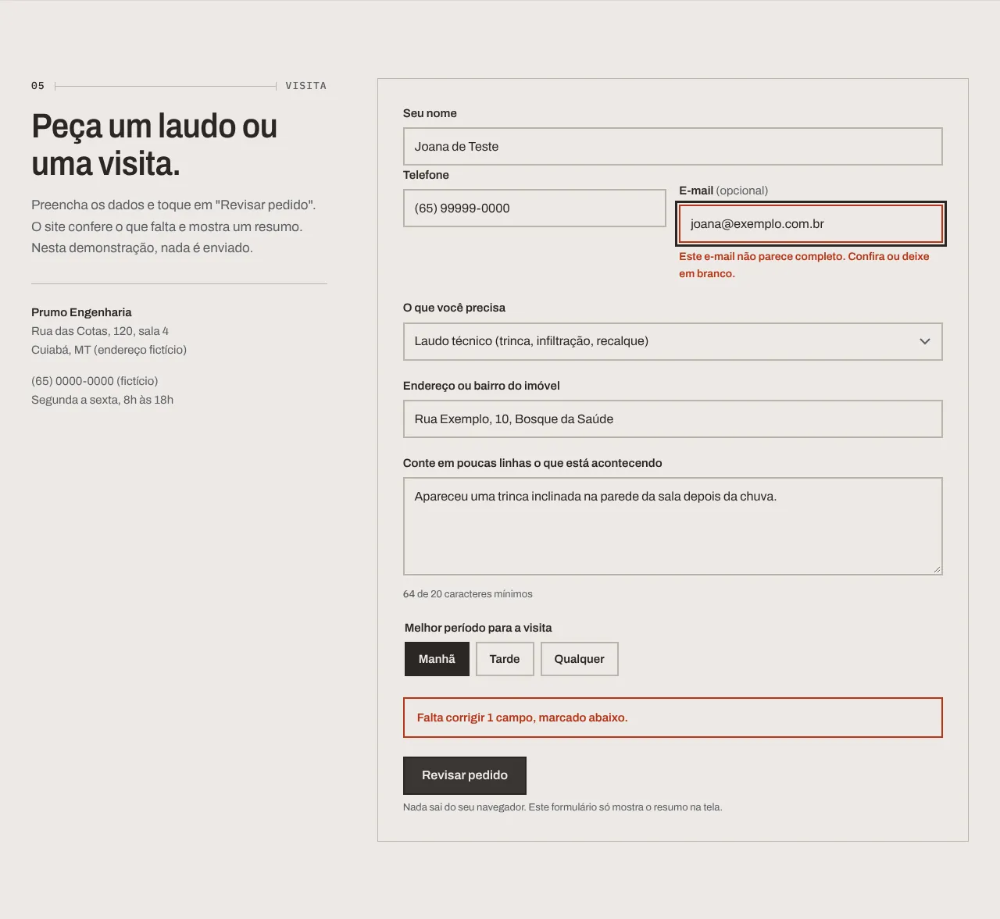

# Prumo Engenharia: site de demonstração para escritórios de engenharia civil

Eu sou o Rodrigo Jr, da [Mil e Uma Linhas!](https://mileumalinhas.com.br), em Cuiabá. Este site é uma demonstração do que eu faço para escritórios de engenharia: um site com identidade própria que não só apresenta o escritório, mas funciona. Dá para estimar o custo de uma obra, ver etapa por etapa quanto tempo ela leva e o que o cliente precisa decidir, filtrar obras por tipo e montar um pedido de visita ou laudo que o site confere antes de resumir.

Site publicado: https://toshiro01001.github.io/engenharia/

**Aviso importante: tudo aqui é fictício.** A Prumo Engenharia não existe. O número do CREA, o endereço, o telefone, as obras do portfólio, os números e os valores por metro quadrado do estimador foram inventados por mim para a demonstração. Nenhum pedido é enviado de verdade, nenhum valor serve de orçamento e nenhum dado sai do seu navegador.



## O que o site faz (para quem não é da área)

Imagine o site de um escritório de engenharia de bairro, daqueles que fazem o cálculo da estrutura da sua casa e vão à obra conferir. Você entra, digita a área da obra e escolhe o padrão de acabamento, e aparece na hora uma faixa de custo com a repartição por etapa. Logo abaixo, uma linha do tempo mostra as oito etapas da obra: você toca em "Estrutura" e vê quantas semanas leva, de que dia a que dia, o que acontece e o que você precisa decidir antes (por exemplo, a posição das janelas). Mais abaixo, as obras já feitas podem ser filtradas por tipo. E, no fim, um formulário de pedido de visita ou laudo confere o que falta e mostra um resumo.

Tudo isso acontece na hora, sem carregar outra página, no celular ou no computador.

## Como usar, passo a passo

1. Abra o site. No alto, toque em "Estimar custo da obra" (ou use o menu "Custo").
2. No estimador, digite a área construída, escolha o tipo de obra (casa, comercial ou galpão), o padrão de acabamento e o número de pavimentos. A faixa de custo e as barras por etapa mudam a cada toque.
3. Toque em "Ver etapa por etapa": o site leva você à linha do tempo já com o porte da obra ajustado pela área que digitou.
4. Na linha do tempo, escolha o mês de início e toque em qualquer etapa (ou use "Próxima etapa"). O painel ao lado mostra a duração, as datas, o que acontece e o que é decisão sua.
5. Em "Obras", toque em um filtro (Residencial, Laudo, Reforma...) para ver só aquele tipo. A contagem acompanha.
6. Em "Visita", preencha nome, telefone, o que precisa, o endereço do imóvel e uma descrição com pelo menos 20 caracteres. Toque em "Revisar pedido". Se faltar algo, o site marca o campo e leva o foco até ele. Se estiver tudo certo, aparece o resumo, com os botões "Corrigir dados" e "Novo pedido".

## Capturas

| Computador | Celular |
|---|---|
|  |  |
|  |  |
|  |  |
|  |  |
|  |  |

## Identidade visual (resumo)

O estudo completo está em [`docs/identidade.md`](docs/identidade.md), inclusive o prompt da foto do hero.

- **Nome e frase:** Prumo Engenharia. "Estrutura calculada, obra acompanhada." O prumo é o fio com peso que mostra a vertical exata: precisão que se vê, sem discurso.
- **Paleta:** Concreto `#ECE9E4` (fundo), Argamassa `#DCD8D1` (apoio), Grafite quente `#2A2724` (texto e seções escuras), Aço `#5B5F66` (texto secundário e cotas), Linha `#B9B4AB` (bordas e grade) e Trena `#F2B705` (a única cor viva, uma vez por tela: o grifo do título, a etapa ativa, o filtro ativo, a barra do acabamento). Fugi de propósito do azul-corporativo e do laranja de capacete: as cores vêm do canteiro, concreto curado, aço e o amarelo da trena.
- **Fontes:** Archivo nos títulos (um pouco condensada, como letra de prancheta) e no texto; IBM Plex Mono em todos os números, cotas, valores e códigos, porque número alinhado em coluna passa precisão. As duas são locais, em `fonts/`, com licença SIL OFL.
- **Grade visível:** linhas finas a cada 64px no fundo das seções escuras e "cotas" (linha com traço nas pontas e rótulo em mono) abrindo cada seção e medindo a foto do hero.
- **Foto do hero:** contêiner 3:2 com cantos retos. A imagem atual em `img/hero.webp` é provisória, gerada com Pillow nas cores da identidade; será trocada pela foto gerada no Canva com o prompt do estudo.
- **Movimento:** só a cota do hero se esticando e o grifo aparecendo na abertura, mais as barras crescendo quando o resultado muda. Com "reduzir movimento" ligado no aparelho, nada se mexe.

## Como funciona por dentro (em linguagem comum)

Pense em uma planilha de orçamento e um cronograma de obra que vivem dentro da página. O site é um conjunto de três arquivos: um com o texto e a estrutura (`index.html`), um com a aparência (`css/estilo.css`) e um com as contas e os comportamentos (`js/app.js`). Quando você mexe em qualquer campo, o navegador do seu aparelho faz a conta e redesenha a tela. Nada é enviado para a internet e nada fica guardado.

- **Estimador:** multiplica a área pelo valor por m² do padrão escolhido, aplica um fator para o tipo de obra (galpão é mais barato por m², comercial um pouco mais caro) e outro para o número de pavimentos, e mostra uma faixa de menos 8% a mais 8%. O total é repartido em seis etapas com percentuais fixos, diferentes para casa, comercial e galpão.
- **Linha do tempo:** oito etapas com duração base em semanas, multiplicada pelo porte (pequena 0,8; média 1,0; grande 1,35). As datas são somadas a partir do primeiro dia do mês escolhido. O diagrama é desenhado com barras cuja posição e largura são proporcionais ao total.
- **Portfólio:** cada obra tem uma etiqueta de tipo. O filtro só esconde as que não combinam e atualiza a contagem.
- **Pedido de visita:** cada campo é conferido (nome, telefone com DDD, e-mail opcional mas válido se preenchido, serviço, endereço, descrição com 20 caracteres, período). Se passar, os dados são copiados para o resumo. O "protocolo" é um número aleatório só para a tela parecer completa.

## Detalhes técnicos

- HTML, CSS e JavaScript puros. Sem framework, sem biblioteca, sem CDN, sem fonte externa, sem analytics.
- `Content-Security-Policy` por meta tag: `default-src 'self'`, sem script inline, sem atributo `style`, `connect-src 'none'`, `form-action 'none'`. As larguras das barras são definidas por CSSOM (`style.setProperty`), permitido pela CSP. Detalhes em [`docs/vistoria.md`](docs/vistoria.md).
- Acessibilidade: contraste AA conferido para todas as combinações da paleta (a maioria AAA), foco visível (grafite no claro, trena no escuro), navegação por teclado no menu, nos filtros, nas etapas e nos formulários, `aria-pressed` nos filtros e nas etapas, `aria-live` nos resultados, mensagens de erro ligadas aos campos por `aria-describedby`, SVGs do portfólio com `title`, `lang="pt-BR"`.
- Celular primeiro: uma coluna a partir de 320px, duas a partir de 600px, grade completa a partir de 900px. Os campos têm 48px de altura e os botões 44px ou mais.
- Fontes locais: Archivo variável (eixos `wght` e `wdth`) e IBM Plex Mono 400 e 500, em woff2 latino, com as licenças ao lado.
- Arquivos: `index.html`, `404.html` (caminhos absolutos em `/engenharia/`), `robots.txt`, `sitemap.xml`, `favicon.svg`, `css/estilo.css`, `js/app.js`, `img/hero.webp`, `fonts/`, `docs/` (identidade, vistoria e capturas), `tests/site.cjs`.

## Como rodar

Não precisa instalar nada para ver o site: é só abrir pelo link publicado. Para rodar localmente do jeito que o GitHub Pages serve (em `/engenharia/`):

```
cd ..            # na pasta que contém engenharia/
python3 -m http.server 8309
```

E abra `http://127.0.0.1:8309/engenharia/`.

## Testes

O arquivo `tests/site.cjs` usa o Playwright (instalado fora do site) para subir o servidor local, abrir o site em três tamanhos (1280x900, iPhone 13 e 320px), exercitar as quatro funções (estimador, linha do tempo, filtro e pedido de visita), conferir que não há erro de console, rolagem horizontal nem texto cortado, e testar a página 404.

```
node tests/site.cjs
CAPTURAS=1 node tests/site.cjs   # também salva as capturas em tests/capturas/
```

## Segurança

Nenhum dado sai do navegador e nada é guardado. Não há `localStorage`, cookies nem `fetch`. A vistoria completa está em [`docs/vistoria.md`](docs/vistoria.md).

## Quem fez

Rodrigo Jr, [Mil e Uma Linhas!](https://mileumalinhas.com.br), Cuiabá, MT. Se você tem um escritório de engenharia e quer um site assim, com a sua identidade e as funções que fazem sentido para o seu trabalho, é só chamar.
